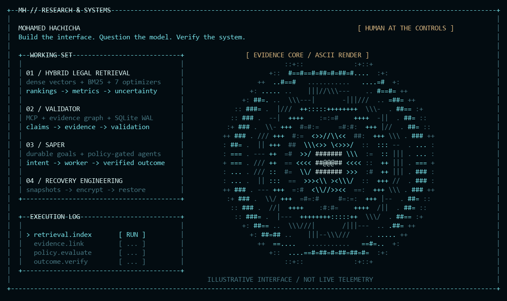

<p align="center">
  
</p>

<p align="center">
  <a href="https://hachicha.netlify.app">Portfolio</a> &nbsp; / &nbsp;
  <a href="https://www.linkedin.com/in/hachicham/">LinkedIn</a> &nbsp; / &nbsp;
  <a href="mailto:contact.hachicha@gmail.com">Email</a> &nbsp; / &nbsp;
  <a href="https://cal.com/mohamed-hachicha-yqcufo/30min">Talk shop</a>
</p>

### I build interfaces people can use—and systems I can explain.

My work sits between retrieval research, agent infrastructure, and product engineering. I like the point where an interesting idea has to survive real data, explicit permissions, and a production deployment.

Lately: comparing retrieval optimizers, giving agents durable evidence, and building tools that check whether their actions actually worked.

### `01 / the interesting problems`

**Hybrid Legal Retrieval · How much does the optimizer actually help?**  
Seven search algorithms, hybrid dense/BM25 retrieval, saved ranking traces, and uncertainty analysis. The work includes reproducible metric audits and manuscript drafts. The question is retrieval performance; generated legal answers are outside the evaluation.

`Python` · `Information retrieval` · `Metaheuristics` · `Experimental design`

**Validator · Give research a memory. Make conclusions earn their place.**  
A private MCP harness for typed evidence graphs, supporting and contradicting observations, and versioned research state. Hypotheses move through deterministic validation gates. A model’s confidence cannot promote them on its own.

`MCP` · `Python` · `SQLite WAL` · `Evidence graphs` — implemented private V1

**SAPER · Let agents execute. Keep policy in charge.**  
An internal control plane connecting durable goals to policy-gated workers, exact-commit CI verification, and draft-PR delivery. The implemented V0 includes restart and idempotency protections; broader security and deployment workflows are still in development.

`Agent orchestration` · `Policy engines` · `GitHub CI` · `Outcome verification`

**Recovery Engineering · The restore is the test.**  
Encrypted snapshots, isolated database restore drills, bounded workloads, and release gates that verify the running application. Operational work where a successful command is only the start of the evidence.

`Linux` · `PostgreSQL` · `Redis` · `restic` · `Docker`

<sub>These projects are private. Descriptions cover the engineering; source, research artifacts, and infrastructure details stay private.</sub>

### `02 / beyond the lab`

Research and systems work feed back into products people use:

| Product | The work |
| :--- | :--- |
| [**Rovelo ↗**](https://rovelo.fr) | Restaurant routines, schedules, HACCP workflows, and the admin tools behind client access and subscriptions. |
| [**Trena ↗**](https://trena.pro) | Multi-tenant gym operations: memberships, reservations, billing, and access workflows. |

### `03 / working stack`

```text
RESEARCH    Python / hybrid retrieval / optimization / LLM integrations
INTERFACES  TypeScript / React / Next.js / Tailwind / Figma
MOBILE      Flutter / Dart / Firebase
SERVICES    Node.js / Express / Spring Boot / ASP.NET
STATE       PostgreSQL / Prisma / Redis / SQLite / MongoDB
DELIVERY    Docker / Coolify / GitHub / automated release checks
```

### `04 / how I work`

<p align="center"></p>

Ask what would prove the idea wrong. Keep the permissions explicit. Make the interface readable. Test the boundary, then check the live result.

That is the thread through the research, the infrastructure, and the product work.

<p align="center"><code>curiosity → experiment → evidence → working software</code></p>
