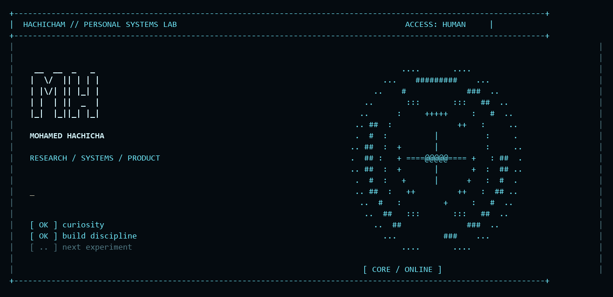
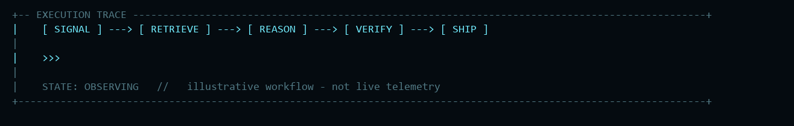

<p align="center">
  
</p>

<p align="center">
  <a href="https://hachicha.netlify.app"><strong>Portfolio</strong></a> &nbsp; / &nbsp;
  <a href="https://www.linkedin.com/in/hachicham/">LinkedIn</a> &nbsp; / &nbsp;
  <a href="mailto:contact.hachicha@gmail.com">Email</a> &nbsp; / &nbsp;
  <a href="https://cal.com/mohamed-hachicha-yqcufo/30min">Let's talk</a>
</p>

```ts
const mohamed = {
  focus: ["product engineering", "interface design", "applied AI"],
  builds: ["web apps", "mobile experiences", "APIs", "admin tools"],
  caresAbout: ["readable UI", "tenant isolation", "reliable releases"],
};
```

I build the parts users see and the systems that keep them working. My work spans product interfaces, backend services, mobile apps, and the deployment work that connects them.

### `01 / research & systems`

Ordered by algorithmic depth, architecture, and systems work.

```text
+-- PROJECT ARCHIVE ---------------------------------------------------+
| 01  HYBRID LEGAL RETRIEVAL       [ research / manuscript drafts ]     |
|     7 optimizers -> dense + BM25 -> ranking audits -> uncertainty     |
|                                                                     |
| 02  VALIDATOR                    [ implemented / private V1 ]        |
|     MCP -> typed evidence graph -> deterministic hypothesis gates    |
|                                                                     |
| 03  SAPER                        [ internal V0 / in development ]    |
|     durable goals -> policy gates -> workers -> verified outcomes    |
|                                                                     |
| 04  RECOVERY ENGINEERING         [ private operational tooling ]     |
|     snapshots -> encryption -> isolated restores -> release gates    |
+---------------------------------------------------------------------+
```

<details>
<summary><strong>Read the technical notes</strong></summary>

- **Hybrid Legal Retrieval:** seven search algorithms evaluated for hybrid dense/BM25 retrieval, with ranking/proposal traces and uncertainty analysis. Manuscript drafts; this evaluates retrieval, not legal-answer correctness.
- **Validator:** a private MCP research harness with typed evidence edges, versioned observations, and deterministic hypothesis transitions. Implemented V1 with a single-writer SQLite WAL architecture.
- **SAPER:** an internal control-plane slice with policy-gated worker execution, exact-commit CI checks, draft-PR delivery, and restart/idempotency protections. Broader security and deployment automation remains in development.
- **Recovery engineering:** encrypted snapshots, isolated database restore drills, bounded workloads, readiness gates, and verification of the live release.

</details>

<sub>Private work is described at a high level. No private source, datasets, infrastructure configuration, or unpublished result artifacts are linked here.</sub>

### `02 / shipped product work`

| Product | What I work on | Explore |
| :--- | :--- | :--- |
| **Rovelo** | Restaurant operations: routines, scheduling, HACCP workflows, and a platform backoffice for clients and subscriptions. | [rovelo.fr](https://rovelo.fr) |
| **Trena** | Gym operations: multi-tenant member management, subscriptions, reservations, billing, and access workflows. | [trena.pro](https://trena.pro) |


### `03 / under the hood`

| Layer | Tools I work with |
| :--- | :--- |
| **Interfaces** | React · Next.js · TypeScript · Tailwind CSS · Figma |
| **Mobile** | Flutter · Dart · Firebase |
| **Services** | Node.js · Express · Spring Boot · ASP.NET |
| **Data** | PostgreSQL · Prisma · MySQL · Redis · MongoDB |
| **Delivery** | Docker · Coolify · GitHub · automated checks |
| **Applied AI** | LLM integrations · retrieval workflows · intelligent agents |

### `04 / engineering notes`

<p align="center"></p>

```text
UI          → clear hierarchy, useful states, responsive layouts
BOUNDARIES  → authentication, permissions, tenant-scoped queries
RELEASES    → typecheck → tests → build → smoke checks → verify live
PRODUCT     → ship a useful slice, listen, improve
```

Good software has to make sense on both sides of the screen: straightforward for the person using it, understandable for the person maintaining it.

<details>
  <summary><strong>More about my background</strong></summary>
  <br />

My earlier work includes ride-sharing web and mobile applications, real-time notifications, and interfaces for local services. I also work across Scrum, product ownership, and UX/UI design.

I’m interested in practical AI: retrieval, recommendations, and agents that fit into a useful product workflow.

</details>

---

<p align="center"><code>design with intent. build with care. ship what works.</code></p>
