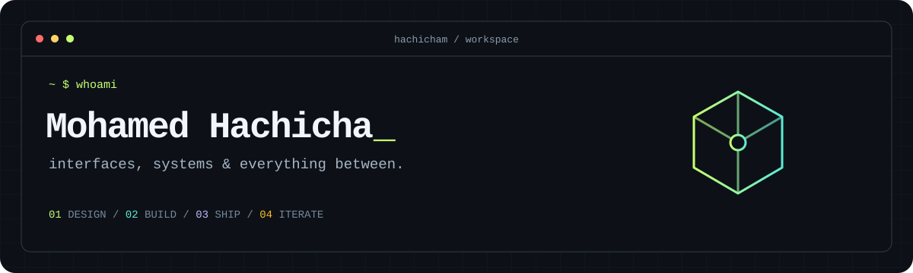

<p align="center">
  
</p>

<p align="center">
  <a href="https://hachicha.netlify.app"><strong>Portfolio</strong></a> &nbsp; / &nbsp;
  <a href="https://www.linkedin.com/in/hachicham/">LinkedIn</a> &nbsp; / &nbsp;
  <a href="mailto:contact.hachicha@gmail.com">Email</a> &nbsp; / &nbsp;
  <a href="https://cal.com/mohamed-hachicha-yqcufo/30min">Let's talk</a>
</p>

```ts
const mohamed = {
  focus: ["product engineering", "interface design", "applied AI"],
  builds: ["web apps", "mobile experiences", "APIs", "admin tools"],
  caresAbout: ["readable UI", "tenant isolation", "reliable releases"],
};
```

I build the parts users see and the systems that keep them working. My work spans product interfaces, backend services, mobile apps, and the deployment work that connects them.

### `01 / research & systems`

Ordered by algorithmic depth, architecture, and systems work.

<table>
  <tr>
    <td width="50%" valign="top">
      <h3>01 — Hybrid Legal Retrieval</h3>
      <p><strong>Metaheuristics meet information retrieval.</strong></p>
      <p>Research comparing seven search algorithms for tuning hybrid dense/BM25 retrieval over legal documents. Saved ranking and proposal traces, reproducible metric audits, and explicit uncertainty analysis.</p>
      <p><code>Python</code> <code>BM25</code> <code>Dense retrieval</code> <code>Optimization</code></p>
      <p><sub>Private research · manuscript drafts and runnable application. Retrieval evaluation, not a claim of legal-answer correctness.</sub></p>
    </td>
    <td width="50%" valign="top">
      <h3>02 — Validator</h3>
      <p><strong>An evidence graph behind the agent.</strong></p>
      <p>A private MCP research harness with typed graph edges, supporting and contradicting evidence, versioned observations, and deterministic hypothesis gates. Model assertions cannot skip validation.</p>
      <p><code>Python</code> <code>MCP</code> <code>SQLite WAL</code> <code>Evidence graphs</code></p>
      <p><sub>Implemented private V1 · single-writer architecture, integrity checks, and persistent research state.</sub></p>
    </td>
  </tr>
  <tr>
    <td width="50%" valign="top">
      <h3>03 — SAPER</h3>
      <p><strong>Software Autonomy Policy &amp; Evidence Runtime.</strong></p>
      <p>An internal control plane for coding-agent work: durable goals, policy-gated execution, exact-commit CI verification, draft-PR delivery, and restart/idempotency protections.</p>
      <p><code>Agent orchestration</code> <code>Policy gates</code> <code>GitHub CI</code> <code>Docker</code></p>
      <p><sub>Internal V0 implemented · broader security and deployment automation remains in development.</sub></p>
    </td>
    <td width="50%" valign="top">
      <h3>04 — Recovery &amp; Release Engineering</h3>
      <p><strong>A backup is a hypothesis until it restores.</strong></p>
      <p>Encrypted snapshots, isolated database restore drills, resource-bounded workloads, and deployment tooling that checks readiness and verifies the live outcome.</p>
      <p><code>PostgreSQL</code> <code>Redis</code> <code>restic</code> <code>Linux</code></p>
      <p><sub>Private operational tooling · tested recovery and evidence-based release gates.</sub></p>
    </td>
  </tr>
</table>

<sub>Private work is described at a high level. No private source, datasets, infrastructure configuration, or unpublished result artifacts are linked here.</sub>

### `02 / shipped product work`

| Product | What I work on | Explore |
| :--- | :--- | :--- |
| **Rovelo** | Restaurant operations: routines, scheduling, HACCP workflows, and a platform backoffice for clients and subscriptions. | [rovelo.fr](https://rovelo.fr) |
| **Trena** | Gym operations: multi-tenant member management, subscriptions, reservations, billing, and access workflows. | [trena.pro](https://trena.pro) |


### `03 / under the hood`

| Layer | Tools I work with |
| :--- | :--- |
| **Interfaces** | React · Next.js · TypeScript · Tailwind CSS · Figma |
| **Mobile** | Flutter · Dart · Firebase |
| **Services** | Node.js · Express · Spring Boot · ASP.NET |
| **Data** | PostgreSQL · Prisma · MySQL · Redis · MongoDB |
| **Delivery** | Docker · Coolify · GitHub · automated checks |
| **Applied AI** | LLM integrations · retrieval workflows · intelligent agents |

### `04 / engineering notes`

```text
UI          → clear hierarchy, useful states, responsive layouts
BOUNDARIES  → authentication, permissions, tenant-scoped queries
RELEASES    → typecheck → tests → build → smoke checks → verify live
PRODUCT     → ship a useful slice, listen, improve
```

Good software has to make sense on both sides of the screen: straightforward for the person using it, understandable for the person maintaining it.

<details>
  <summary><strong>More about my background</strong></summary>
  <br />

My earlier work includes ride-sharing web and mobile applications, real-time notifications, and interfaces for local services. I also work across Scrum, product ownership, and UX/UI design.

I’m interested in practical AI: retrieval, recommendations, and agents that fit into a useful product workflow.

</details>

---

<p align="center"><code>design with intent. build with care. ship what works.</code></p>
