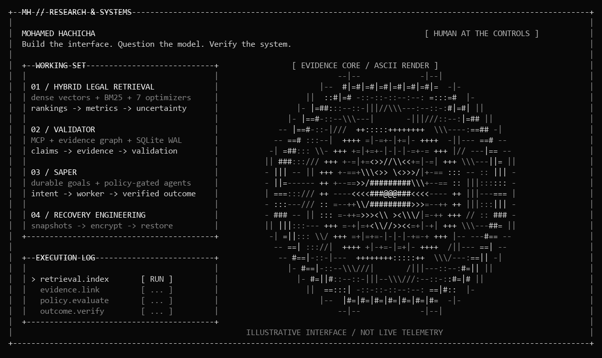
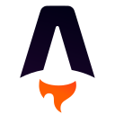
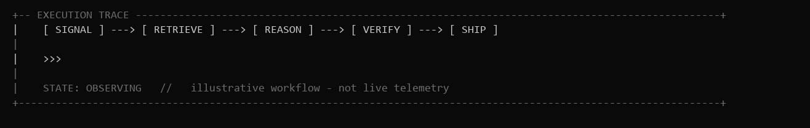

<p align="center">
  
</p>

<p align="center">
  <a href="https://hachicha.netlify.app"></a>
  <a href="https://www.linkedin.com/in/hachicham/"></a>
  <a href="https://github.com/HachichaM"></a>
  <a href="mailto:contact.hachicha@gmail.com"></a>
  <a href="https://cal.com/mohamed-hachicha-yqcufo/30min"></a>
</p>

# Mohamed Hachicha

**Full stack developer ? Platform engineer ? Applied AI researcher**

- Build web applications, mobile apps, and the APIs behind them.
- Build backend services with Node.js and Python, with an earlier foundation in Java, Scala, and C#/.NET.
- Research hybrid retrieval, optimization algorithms, and evidence driven AI.
- Build agent tools with MCP, persistent state, and explicit policy gates.
- Engineer deployment pipelines, recovery workflows, and production checks.
- Design readable interfaces for real operational work.

### `01 / flagship research & systems`

**Hybrid Legal Retrieval · How much does the optimizer actually help?**  
Seven search algorithms, hybrid dense/BM25 retrieval, saved ranking traces, and uncertainty analysis. The work includes reproducible metric audits and manuscript drafts. The question is retrieval performance; generated legal answers are outside the evaluation.

`Python` · `Information retrieval` · `Metaheuristics` · `Experimental design`

**Validator · Give research a memory. Make conclusions earn their place.**  
A private MCP harness for typed evidence graphs, supporting and contradicting observations, and versioned research state. Hypotheses move through deterministic validation gates. A model’s confidence cannot promote them on its own.

`MCP` · `Python` · `SQLite WAL` · `Evidence graphs` — implemented private V1

**SAPER · Let agents execute. Keep policy in charge.**  
An internal control plane connecting durable goals to policy-gated workers, exact-commit CI verification, and draft-PR delivery. The implemented V0 includes restart and idempotency protections; broader security and deployment workflows are still in development.

`Agent orchestration` · `Policy engines` · `GitHub CI` · `Outcome verification`

**Recovery Engineering · The restore is the test.**  
Encrypted snapshots, isolated database restore drills, bounded workloads, and release gates that verify the running application. Operational work where a successful command is only the start of the evidence.

`Linux` · `PostgreSQL` · `Redis` · `restic` · `Docker`

<sub>These projects are private. Descriptions cover the engineering; source, research artifacts, and infrastructure details stay private.</sub>

### `02 / flagship products`

Research and systems work feed back into products people use:

| Product | The work |
| :--- | :--- |
| [**Rovelo ↗**](https://rovelo.fr) | Restaurant routines, schedules, HACCP workflows, and the admin tools behind client access and subscriptions. |
| [**Trena ↗**](https://trena.pro) | Multi-tenant gym operations: memberships, reservations, billing, and access workflows. |

### More recent builds

| Project | Engineering focus | Technologies |
| :--- | :--- | :--- |
| **Darset** | A commerce control panel with separate backend, database, cache, storage, and credentials for each merchant. | Medusa ? PostgreSQL ? Redis ? Docker |
| **BuildRelay** | A construction workspace connecting project documents to cited answers, structured records, and reviewable follow-ups. | Next.js ? TypeScript ? Supabase ? Python |
| **Arka Shop** | A board-game storefront and commerce backend with bounded connection pools, dependency readiness checks, and shared Redis workflows. | Next.js ? Medusa v2 ? PostgreSQL ? Redis |
| **Dada Creations** | Storefront commerce infrastructure with separate API and worker processes, shared locks and events, and controlled migrations. | Medusa v2 ? Node.js ? PostgreSQL ? Redis |

<sub>Repository scope and implementation vary. Private source stays private.</sub>

### Earlier foundations

Java, Scala, and C#/.NET are part of my earlier engineering background. Ecoloop combines React and Java for ride sharing, reservations, and ratings. These foundations sit alongside the newer research, platform, and product work above.

### `03 / platform engineering`

I build the path from a repository to a running service: the checks that decide whether a release can proceed, the deployment boundary, and the evidence that it worked.

**Production Engineering Runbook & Operator Console**  
A workload-aware engineering workflow backed by a machine-readable control catalogue and a Node.js operator console. Read-only discovery comes first; deterministic gates control production writes. The system brings risk assessment, release readiness, immutable references, and rollback planning into the same workflow.

**VPS Recovery & Operations**  
Private infrastructure automation for encrypted backups, isolated PostgreSQL/Redis/SQLite recovery checks, host monitoring, and resource-bounded workloads. Restore drills test the recovery path; post-deployment checks test the running service.

```text
                      THE DELIVERY PATH

  source -> CI gates -> versioned artifact -> deploy -> readiness
                |                               |          |
             evidence                        rollback   live checks

  PLATFORM CONCERNS
  [x] workload discovery         [x] explicit write boundaries
  [x] tenant & access isolation  [x] resource limits
  [x] recovery verification      [x] release evidence
```

`Platform engineering` · `SRE practices` · `CI/CD` · `Linux` · `Containers` · `Recovery`

### `04 / technologies across my work`

Tools used across current products, research code, desktop applications, and earlier projects. This is a working inventory, not a claim of equal depth in every tool.

**Languages & foundations**

TypeScript · JavaScript · Python · SQL · Dart · HTML · CSS / Sass  
Earlier experience: C# · .NET / ASP.NET · Java / Spring Boot · Scala

<p>
   &nbsp;
   &nbsp;
   &nbsp;
   &nbsp;
   &nbsp;
   &nbsp;
   &nbsp;
  
</p>

| Area | Technologies |
| :--- | :--- |
| **Web applications** | React · Next.js · Astro · Vite · React Router · Tailwind CSS · Radix UI |
| **State & data fetching** | TanStack Query · Zustand · SWR · Axios · Zod |
| **Motion & graphics** | Three.js · React Three Fiber / Drei · GSAP · Motion / Framer Motion · OGL · Lenis |
| **Mobile & desktop** | Flutter · Riverpod · GoRouter · Dio · Firebase Cloud Messaging · Electron · electron-builder / updater |
| **Backend & APIs** | Node.js · NestJS · Express · Fastify · FastAPI · Pydantic · REST · OpenAPI / Swagger · WebSockets |
| **Data & persistence** | PostgreSQL · Redis · SQLite · MySQL · Prisma · Drizzle ORM · TypeORM · SQLAlchemy · Alembic · Supabase |
| **Research & retrieval** | NumPy · BM25 / rank-bm25 · sentence-transformers · FAISS · Hugging Face Hub · PyMuPDF · hybrid retrieval · metaheuristic optimization |
| **AI integrations** | MCP · OpenAI SDK · Google Generative AI SDK · LLM application workflows · persistent evidence graphs |
| **Jobs & workflows** | BullMQ · Temporal · pg-boss · separate worker processes · Redis event, cache, and locking providers |
| **Commerce & content** | Medusa v2 · Payload CMS · Stripe · Cloudinary · S3-compatible storage via AWS SDK |
| **Identity & security** | Auth.js / NextAuth · Better Auth · Passport · JWT / JOSE · Argon2 / bcrypt · Cloudflare Turnstile · tenant-scoped access |
| **Quality & testing** | Playwright · Vitest · Jest · Testing Library · Supertest · fast-check · pytest · Python unittest · ESLint · TypeScript checks |
| **Platform & operations** | Linux · Docker / Compose · Coolify · GitHub Actions · NGINX · restic · Sentry · Pino · readiness checks · restore verification |
| **Build & developer tools** | Git · pnpm / npm · Turborepo · uv · esbuild · Figma · LaTeX / XeLaTeX · Biber |
| **Localization & communication** | i18next / react-i18next · Nodemailer · Firebase notifications · IMAP tooling |

**Interfaces, services, and runtime**

<p>
   &nbsp;
   &nbsp;
   &nbsp;
   &nbsp;
   &nbsp;
   &nbsp;
   &nbsp;
   &nbsp;
  
</p>

**Data, testing, and delivery**

<p>
   &nbsp;
   &nbsp;
   &nbsp;
   &nbsp;
   &nbsp;
   &nbsp;
   &nbsp;
   &nbsp;
  
</p>

<details>
<summary><strong>Where the stack comes from</strong></summary>

- **Rovelo:** React/Vite, NestJS/TypeORM, Flutter/Riverpod, Firebase messaging, Payload CMS.
- **Trena / CREP:** Next.js/Prisma, Redis/BullMQ, Electron, Playwright, and production release checks.
- **GTMAG:** Fastify, Drizzle, PostgreSQL, Pino, MCP, and worker services.
- **GCM:** Temporal workflows, browser workers, and separate media/publication services.
- **Pager:** Three.js, graphics components, and Google Generative AI integration.
- **Arka and commerce projects:** Astro, Medusa, Next.js, Redis workflows, and PostgreSQL.
- **Legal retrieval application:** FastAPI/Pydantic, SQLAlchemy/Alembic, NumPy, rank-bm25, and semantic-retrieval dependencies for sentence-transformers/FAISS.
- **Validator:** Python MCP SDK, SQLite-backed research state, and pytest.
- **Earlier projects:** Java application code and the C#/.NET and Scala background described above.

The inventory was checked against 67 local manifests, selected private repository manifests, and source imports. Forked demo stacks and generated native-platform files were excluded. Dependency presence establishes project use, not production maturity or expert-level experience. Optional semantic retrieval dependencies remain optional.

</details>

<sub>Technology artwork from <a href="https://github.com/devicons/devicon">Devicon</a>. See the attribution and license in <a href="./assets/tech/README.md">assets/tech</a>.</sub>

### `05 / how I work`

<p align="center"></p>

Ask what would prove the idea wrong. Keep the permissions explicit. Make the interface readable. Test the boundary, then check the live result.

That is the thread through the research, the infrastructure, and the product work.

<p align="center"><code>curiosity → experiment → evidence → working software</code></p>
